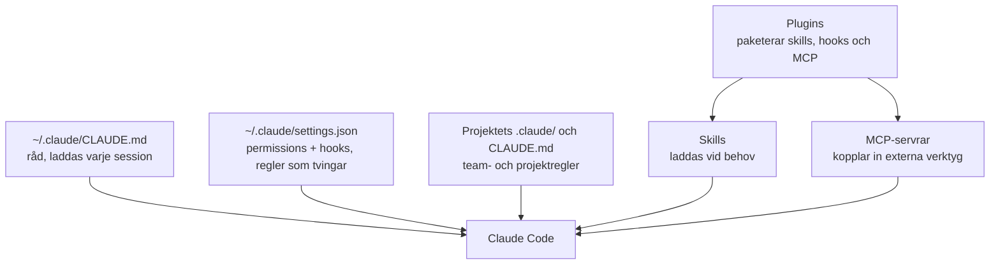

# Claude Code i WSL Ubuntu: grundmanual

*Senast ändrat: 2026-11-10. Status: underlag för beslut. Kontrollera sökvägar och syntax mot din version med `/status` och `/permissions`.*

**Slutsats:** börja litet. En kort global `CLAUDE.md`, en `settings.json` med permissions, noll till två hooks, inga egna skills, inga plugins. Lägg till MCP-servrar först när du behöver dem.

## Så hänger delarna ihop



**CLAUDE.md är råd, medan permissions och hooks är en spärr.** Det du inte får riskera lägger du i `settings.json`, inte i texten.

## 0. WSL-grunden

- Lägg projekt under `~/projekt/…` i Linux-filsystemet, inte under `/mnt/c/…`. Det är snabbare och undviker problem med behörigheter och radslut.
- `~/.claude/` ligger i WSL:s hemkatalog och är skild från din Windows-installation. Inställningar delas inte automatiskt.
- Installera Node/npm och git inne i WSL, inte via Windows.
- Verifiera: `claude --version`, `/status`, `/doctor`.

## 1. Permissions (`~/.claude/settings.json`)

Regelordningen är **deny, sedan ask, sedan allow**. En deny vinner alltid.

```json
{
  "permissions": {
    "defaultMode": "default",
    "allow": [
      "Bash(git status)",
      "Bash(git diff *)",
      "Bash(git log *)",
      "Bash(ls *)",
      "Bash(npm run test *)"
    ],
    "ask": [
      "Bash(git commit *)",
      "Bash(git push *)"
    ],
    "deny": [
      "Read(./.env)",
      "Read(./.env.*)",
      "Read(~/.ssh/**)",
      "Read(~/.aws/**)",
      "Bash(sudo *)",
      "Bash(rm -rf *)"
    ]
  }
}
```

- Börja med `defaultMode: "default"`, alltså att den frågar. Lägg till i `allow` först när du tröttnar på samma fråga.
- Använd aldrig `bypassPermissions` på din vanliga dator.
- Ett deny-mönster på kommandotext är ingen riktig säkerhetsgräns, eftersom samma sak kan göras på andra sätt. Hemligheter skyddar du bäst genom att inte ha dem i projektkatalogen.
- Kontrollera syntaxen i din version med `/permissions`.

## 2. Hooks (avsnittet `hooks` i `settings.json`)

Hooks körs av programmet, inte av Claude, och är den enda tillförlitliga vägen för "gör alltid X när Y händer". Du behöver inga från start. Två användbara kandidater:

- **PreToolUse på `Bash`**, som blockerar farliga kommandon med exit-kod 2. Komplement till deny-reglerna.
- **Notification eller Stop**, som ger en signal när Claude väntar på dig.

Testa varje hook innan du litar på den: mata in exempel-JSON i kommandot och kontrollera exit-kod och effekt. En trasig `settings.json` stänger av alla inställningar i filen, så validera med `jq . ~/.claude/settings.json`.

## 3. Global CLAUDE.md (`~/.claude/CLAUDE.md`)

Håll den under cirka 60 rader och skriv bara sådant som gäller **alla** projekt. Nämn aldrig ett enskilt projekt, en stack eller en sökväg. Projektspecifikt hör hemma i projektets egen `CLAUDE.md`.

```markdown
# Globala regler
- Svara på svenska. Slutsatsen först, kort förklaring varför.
- Fråga innan du raderar, skriver över eller pushar.
- Läs filen innan du ändrar den. Gissa inte om hur koden ser ut.
- Kör tester eller kontrollkommandon innan du säger att något är klart.
- Lägg aldrig hemligheter (nycklar, tokens) i kod, loggar eller commits.
- Avsluta uppdrag med: Gjort · Hinder · Nästa steg.
```

Anpassa raderna efter dina preferenser.

## 4. Skills

- Personliga skills ligger i `~/.claude/skills/<namn>/SKILL.md`, projektskills i `.claude/skills/`.
- Börja utan egna skills. Skapa en först när du ber om samma procedur för tredje gången.
- Varje skills beskrivning läses in varje session. Många skills kostar alltså kontext.

## 5. Plugins

- Installeras med `/plugin`. Ett plugin kan bunta skills, hooks, agenter och MCP-servrar.
- Installera sparsamt. Varje plugin lägger till kod som körs hos dig, så läs vad det gör och ta bara sådant du känner igen källan till.
- Ett rimligt första val är något för kodgranskning eller dokumentation, och först när du har ett konkret behov.

## 6. MCP

- Lägg till med `claude mcp add --scope user …` (alla projekt) eller `--scope project` (delas via `.mcp.json`).
- Varje server ger Claude nya befogenheter, till exempel läsa och skriva i GitHub eller Notion. Ge minsta möjliga behörighet och använd bara-läsa-tokens när det går.
- Lägg aldrig tokens i filer som hamnar i git. Använd miljövariabler.
- Kontroll: `claude mcp list` och `/mcp`.

## Rekommenderad ordning

1. Kontrollera WSL-grunden (avsnitt 0).
2. Lägg in `settings.json` med permissions.
3. Skriv den globala `CLAUDE.md`.
4. Använd Claude i ett par veckor och notera vad den frågar om i onödan.
5. Lägg då till hooks, skills och MCP vid verkligt behov.
